# SongGrabber · by Pezhy

> Früher „AudioGrabber“. Beim ersten Start werden Einstellungen, Bibliothek und Abos aus `%APPDATA%\AudioGrabber` übernommen; das Setup entfernt eine alte AudioGrabber-Installation automatisch.

## ⬇ Download
**[Neueste Version herunterladen](https://github.com/Pezhy69/SongGrabber/releases/latest)** – kostenlos, ohne Werbung, ohne Konto.
- **Windows 10/11:** `SongGrabber-Setup-<Version>.exe` starten.
- **Linux** (Ubuntu, Mint, Debian, Fedora, Arch, openSUSE): `SongGrabber-<Version>-linux.tar.gz` entpacken, im Ordner `./install.sh` ausführen. Danach steht SongGrabber im Startmenü.

## 🇬🇧 English
**SongGrabber is a free audio grabber and music player for Windows and Linux – now fully in English.** It follows your Windows language automatically; switch any time under *Settings → Language* (the built-in help is translated too).

- **Links & streams** – YouTube, SoundCloud, Bandcamp, Mixcloud, playlists, internet radio → MP3 (LAME), WAV or FLAC with ID3 tags, cover, album info and lyrics
- **Audio CD** – bit-exact ripping, track info and cover from MusicBrainz
- **Recording** – vinyl, cassette, system sound or microphone with level meter, auto start and automatic track splitting
- **Screen recording** – Zoom, Teams, webinars as MP4, whole screen, one window or a drawn area, with PC sound and/or microphone
- **Karaoke** – sing karaoke videos from YouTube without ads, change key & tempo, TV mode, points & leaderboard, ⚔️ battle and 👥 duet, record your voice + music
- **Karaoke party** – guests scan a QR code and request songs from their phone (no app), fair order, “Offline only” switch for camping
- **Player** – nine light shows, equalizer, crossfade, synced lyrics, mini player, radio & podcasts, quick radio recording
- **Library** – search, tag editor, clean-up of duplicates, playlists, transfer to USB stick/phone

Download: **[latest release](https://github.com/Pezhy69/SongGrabber/releases/latest)** – free, no ads, no account. Please only save content you have the rights to.

## So sieht es aus

<p align="center">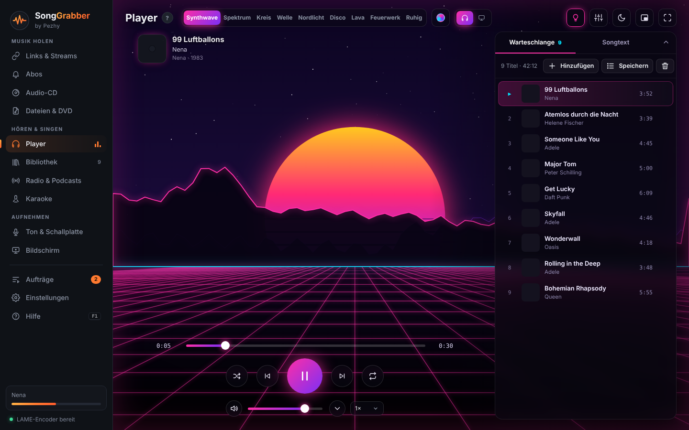</p>

| | |
|---|---|
| 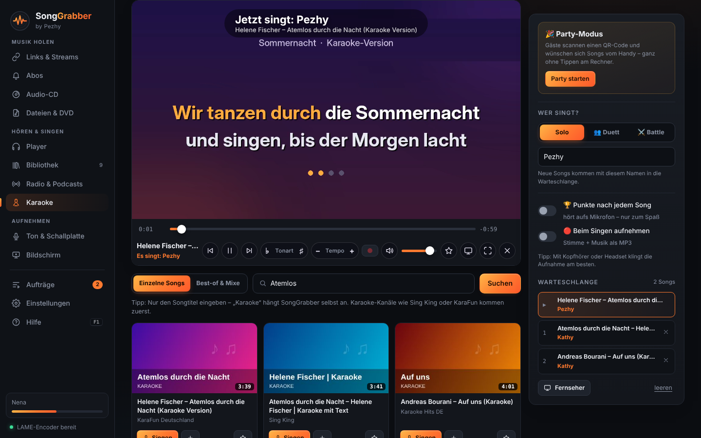<br><sub><b>Karaoke</b> – Karaoke-Videos von YouTube ohne Werbung, Tonart & Tempo, Fernseher-Modus, „Wer singt?“-Warteschlange</sub> | 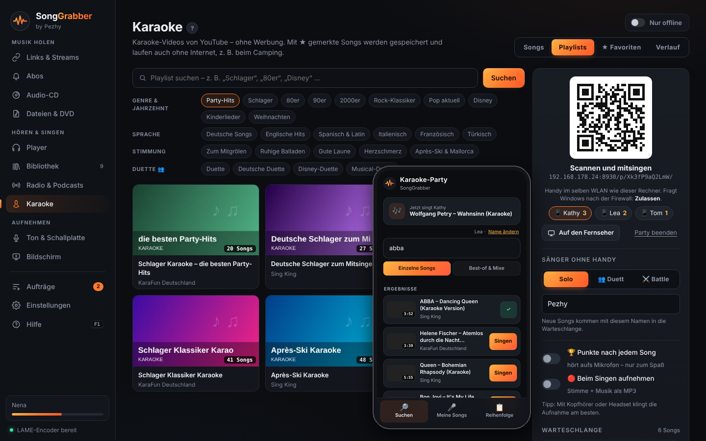<br><sub><b>🎉 Party-Modus</b> – Gäste scannen den QR-Code und wünschen sich Songs vom Handy; Playlists nach Genre, Sprache, Stimmung und Duetten</sub> |
| 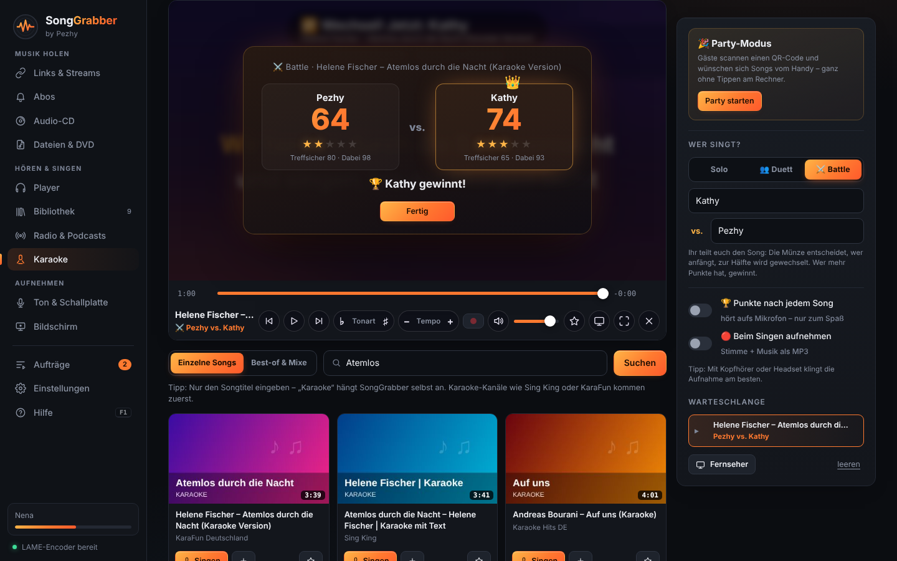<br><sub><b>⚔️ Battle & 👥 Duett</b> – zwei gegeneinander oder zusammen, mit Punkten, Sieger und Bestenliste</sub> | 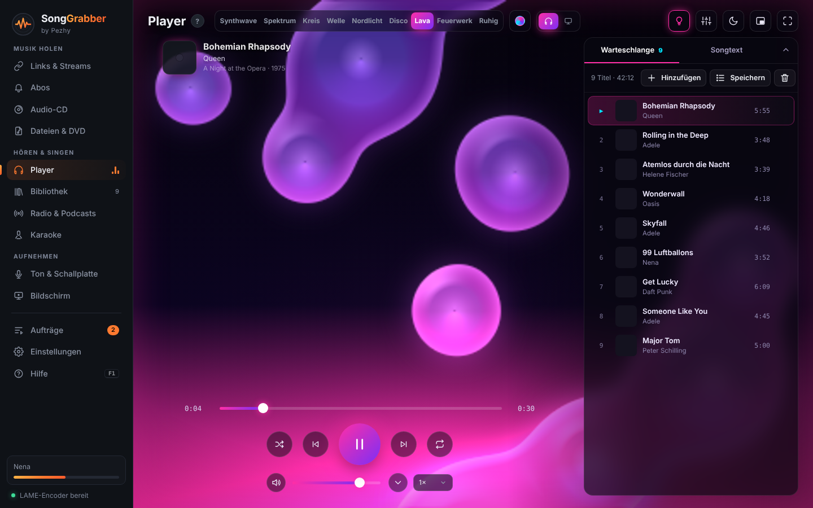<br><sub><b>Lichtshow „Lava“</b> – eine von neun Lichtshows, alle im Takt der Musik</sub> |
| 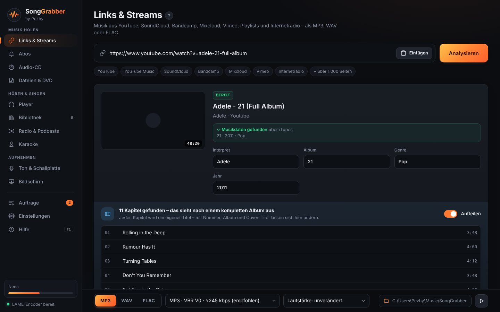<br><sub><b>Links & Streams</b> – ganze Alben von YouTube & Co., automatisch in Titel geteilt und getaggt</sub> | 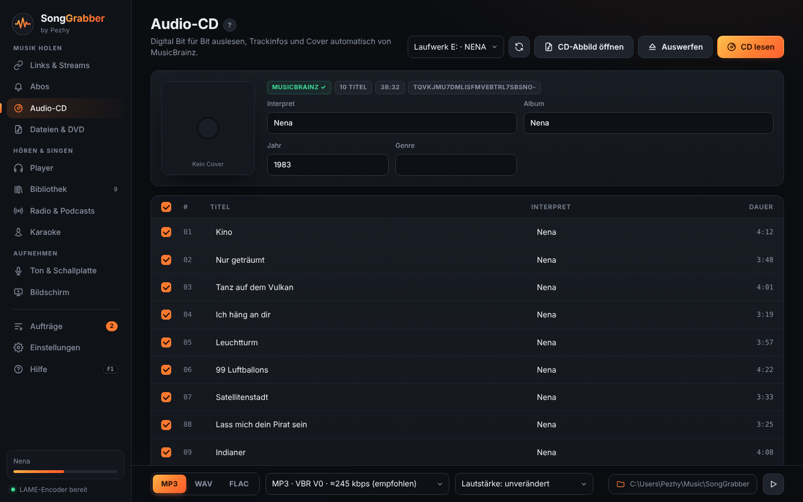<br><sub><b>Audio-CD</b> – Bit für Bit gelesen, Titel und Cover von MusicBrainz</sub> |
| 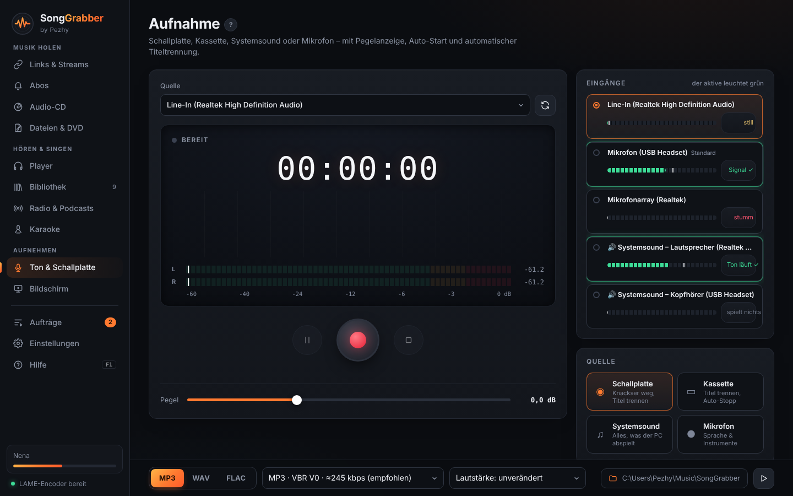<br><sub><b>Ton & Schallplatte</b> – Schallplatte, Kassette, Systemsound oder Mikrofon mit Pegelanzeige</sub> | 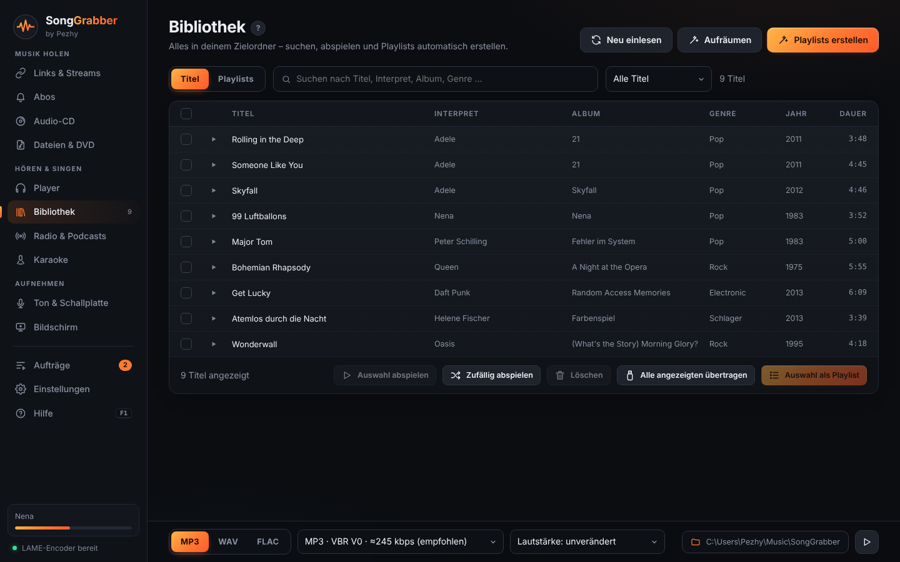<br><sub><b>Bibliothek</b> – suchen, abspielen, aufräumen, Playlists erstellen</sub> |
| 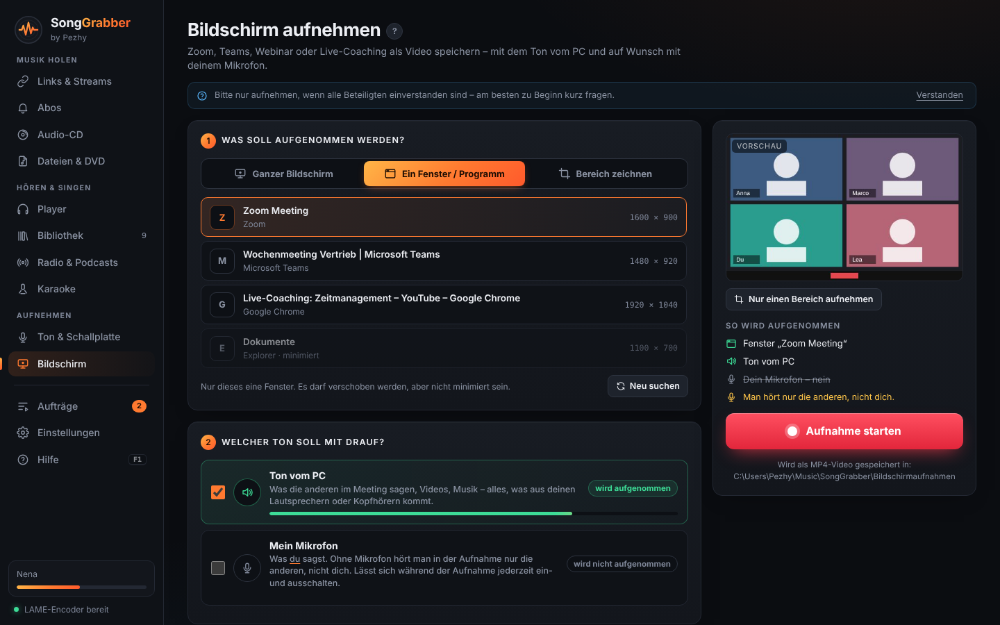<br><sub><b>Bildschirm aufnehmen</b> – Zoom, Teams, Webinare als Video; klar sichtbar, ob PC-Ton und Mikrofon mit drauf sind</sub> | 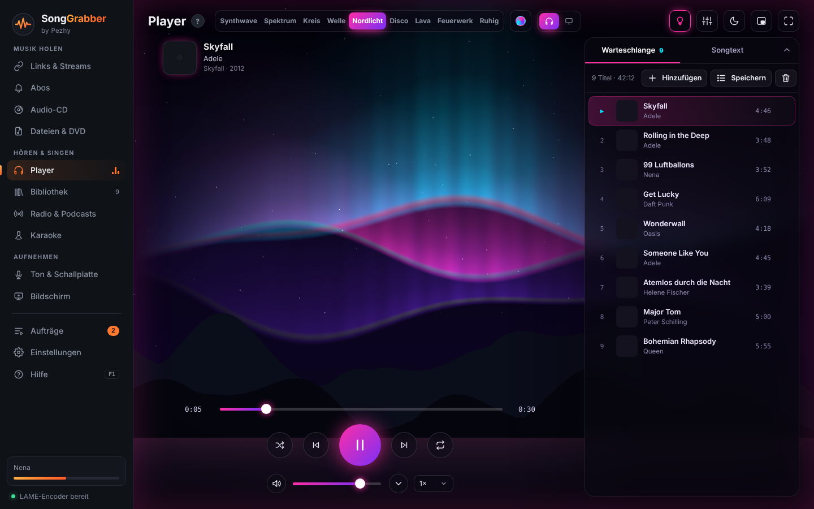<br><sub><b>Lichtshow „Nordlicht“</b> – Lichtschleier über Bergen, Bass hebt sie an</sub> |
| 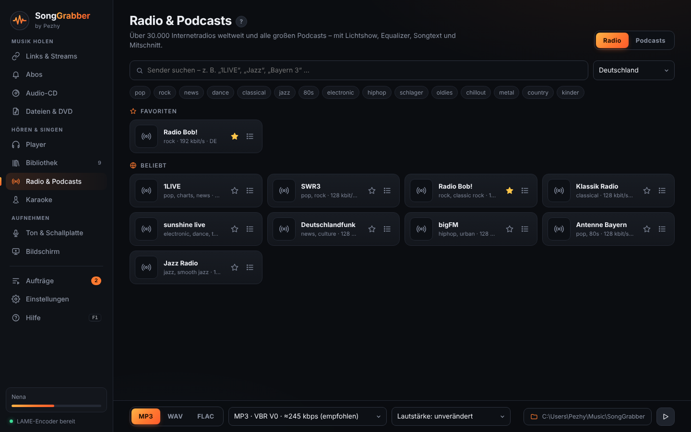<br><sub><b>Radio & Podcasts</b> – über 30.000 Sender mit Songtext und Sofort-Mitschnitt</sub> | <sub><b>Player</b> (oben) – neun Lichtshows mit eigenen Farben, Equalizer, mitlaufender Songtext, Mini-Player, Überblenden</sub> |

Audio von **Audio-CD, Links/Streams, Schallplatte/Kassette/Systemsound und Dateien/DVD** – dazu **Bildschirmaufnahmen als Video** (Zoom, Teams, Webinare) – als
**MP3 (LAME), WAV oder FLAC** – mit ID3-Tags, Cover und schöner Oberfläche. Läuft komplett autark
als portabler Ordner (nichts installieren) und lässt sich mit dem **Multi Video Downloader** koppeln.

## Linux
`install.sh` installiert die Systempakete (Python 3, PyGObject, WebKit2GTK 4.1, ffmpeg, GStreamer-Plugins, Chromaprint) über apt/dnf/pacman/zypper, legt SongGrabber in `~/.local/share/SongGrabber` mit eigener Python-Umgebung an (pywebview, mutagen, soundcard, numpy, yt-dlp, jeepney, send2trash) und erzeugt Startmenü-Eintrag und Befehl `songgrabber`.
Einstellungen: `~/.config/SongGrabber`. Systemsound/„Alles am PC“ über PulseAudio/PipeWire und MPRIS, Audio-CDs über `/dev/sr*` (Gruppe `cdrom`).
**Automatik:** `.github/workflows/linux.yml` baut bei jedem veröffentlichten Release das Paket (`packaging/linux/build.sh`), installiert es zur Probe auf frischem Ubuntu, wandelt eine Testdatei um und hängt `SongGrabber-<Version>-linux.tar.gz` ans Release.

## Installieren wie ein normales Programm (Windows)
`build.bat` erzeugt zusätzlich **`Setup\SongGrabber-Setup-<Version>.exe`** (Inno Setup wird bei Bedarf
automatisch über winget installiert). Das Setup bietet:
- Installation „nur für mich“ (ohne Admin-Rechte) oder „für alle Benutzer“ (C:\Programme)
- eigene Seite „Speicherort für deine Musik“ (Standard: Musik\SongGrabber, z. B. D:\Musik für ein Archiv; bei Updates bleibt der aktuelle Ordner)
- Startmenü-Eintrag, optional Desktop-Symbol
- optional Rechtsklick im Explorer: **„Mit SongGrabber umwandeln“** für Audio- und Videodateien
- Deinstallation über *Einstellungen → Apps*; Einstellungen liegen in `%APPDATA%\SongGrabber`
- Update: einfach das neue Setup drüber installieren (laufendes Programm wird automatisch geschlossen)
- Prüfung auf die Microsoft-WebView2-Laufzeit

Da das Setup nicht digital signiert ist, zeigt Windows beim ersten Start evtl. „Der Computer wurde durch
Windows geschützt“ → *Weitere Informationen* → *Trotzdem ausführen*.

## Schnellstart (Windows)
1. Python 3.10+ installiert haben.
2. `build.bat` doppelklicken. Das Skript
   - installiert pywebview, soundcard, numpy, mutagen, PyInstaller (optional winrt für „Alles am PC“),
   - holt einmalig `ffmpeg.exe`, `ffprobe.exe` (mit LAME) und `yt-dlp.exe` nach `bin\`
     (oder: `python tools\fetch_tools.py --from "<Video-Downloader>\bin"` kopiert sie von dort),
   - baut `dist\SongGrabber\SongGrabber.exe`.
3. Den Ordner `dist\SongGrabber` beliebig kopieren (USB-Stick, anderer PC) – fertig.
   Einstellungen liegen dank `portable.txt` im Unterordner `data\`.

Zum Ausprobieren ohne Build: `start_dev.bat`.

## Funktionen
| Bereich | Was es kann |
|---|---|
| **Links & Streams** | YouTube, YT Music, SoundCloud, Bandcamp, Mixcloud, Vimeo u. v. m. (yt-dlp), ganze Playlists mit Auswahl, Interpret/Titel automatisch aus dem Videotitel, Vorschaubild als quadratisches Cover. **Live-Mitschnitt** von Internetradio/Streams mit optionaler Dauer. |
| **Audio-CD** | Digitales Auslesen (Raw-Read, 2352-Byte-Sektoren), Prüflesen mit Wiederholung, MusicBrainz-Disc-ID → Interpret, Album, Titel, Jahr, Cover; Auswahl bei mehreren Veröffentlichungen; eigenes Cover per Klick; .m3u8-Playlist; Auswerfen. |
| **Karaoke** | Karaoke-Videos von YouTube ohne Werbung suchen (einzelne Songs oder lange Best-of-Videos mit Songliste), fertige Playlists, Sänger-Warteschlange mit „Jetzt singt …“, Vollbild. ★-Favoriten werden gespeichert und laufen offline. Sich selbst aufnehmen: Stimme + Musik als MP3/MP4. |
| **Bildschirm aufnehmen** | Ganzer Bildschirm, ein Fenster (Zoom, Teams, Browser …) oder ein **gezeichneter Bereich** als MP4-Video. Ton vom PC und Mikrofon getrennt wählbar und klar beschriftet, Mikro während der Aufnahme an/aus, Pegelanzeigen, Pause, kleine Aufnahme-Leiste (unter Windows im Video unsichtbar), optional zusätzlich MP3. Windows Graphics Capture bzw. X11 unter Linux. |
| **Aufnahme** | Line-In (Plattenspieler, Kassettendeck), Mikrofon, **Systemsound** (WASAPI-Loopback). LED-Pegelmeter mit Peak-Hold, Wellenform, Clip-Warnung, Pegelregler. Start bei Signal, Stopp nach Stille, **automatische Titeltrennung** an Pausen, Knackser-/Rumpelfilter, 16/24 Bit bis 96 kHz. |
| **Dateien & DVD** | Jedes Audio-/Videoformat, ganze Ordner, Tonspur-Auswahl, DVD-Video (VIDEO_TS). Tags werden übernommen und sind bearbeitbar. |
| **Encoder** | MP3 VBR V0/V2, CBR 128–320 (LAME, höchste Algorithmus-Qualität, ID3v2.3+v1) · WAV 16/44,1 – 24/96 · FLAC 16/24 Bit. Optional Normalisieren (-1 dB Spitze) oder Lautheit (-14 LUFS), Stille kürzen. |
| **Musikdaten online** | Album, Genre, Jahr, Titelnummer und echtes Albumcover werden automatisch über den iTunes-Katalog gesucht (Ersatz: MusicBrainz). Original-Studioalben werden gegenüber Samplern, Singles und Live-Versionen bevorzugt. |
| **Live-Erkennung** | Erkennt Live-Auftritte (Titel wie „Live at …“, „Unplugged“, Konzert, frühere Livestreams) und schlägt die Studioaufnahme bzw. das offizielle Video von YouTube vor – oder die Live-Version wird behalten und als „(Live)“ gekennzeichnet. Abschaltbar. |
| **Hilfe** | Eingebaute Anleitung (F1 oder „?“ neben jeder Überschrift öffnet den passenden Abschnitt), Begrüßung beim ersten Start. |
| **Full-Album-Videos** | Videos mit Kapiteln (z. B. „Album XY (Full Album)“) werden erkannt und in einzelne, nummerierte Titel mit Album, Jahr, Genre und Albumcover geteilt. |
| **Musikerkennung** | Audio-Fingerabdruck (Chromaprint/fpcalc + AcoustID, kostenloser Schlüssel nötig): Aufnahmen von Platte/Kassette werden nach dem Teilen automatisch benannt; per Rechtsklick für jede Datei. |
| **Tag-Editor** | Titel, Interpret, Album, Nr., Jahr, Genre, Cover und Songtext bearbeiten – auch für viele Dateien gleichzeitig, mit „Online ergänzen“; Datei wird passend umbenannt/einsortiert. Unterstützt MP3, WAV, FLAC, OGG/Opus, M4A. |
| **Songtexte** | Automatisch von lrclib.net (kostenlos), mitlaufend (LRC) wo verfügbar; Anzeige im Player mit Zeilen-Sprung; optional .lrc-Datei. |
| **Übertragen** | Auswahl/Playlist auf USB-Stick, SD-Karte oder Handy; „Autoradio-sicher“ (MP3 192 kbps/44,1 kHz, Cover 500 px), Nummerierung, Playlist auf dem Ziel. |
| **Abos** | YouTube-Kanäle/Playlists beobachten, neue Titel automatisch laden (Intervall einstellbar, Live-Auftritte überspringbar); optional Autostart mit Windows (minimiert). |
| **Kürzen** | Wellenform mit Griffen, Vorschlag für Stille/Rauschen/Applaus/Ausblendung, Anhören vor dem Schnitt, verlustfreier Schnitt (optional sanftes Ein-/Ausblenden). |
| **Player** | Eigene Player-Seite mit Lichtshow (Synthwave, Spektrum, Kreis, Welle, Nordlicht, Disco-Kugel, Lava-Lampe, Feuerwerk, Ruhig; reagiert live auf Bass/Beat; Seitenleiste und Bedienung lassen sich wegklappen), Farbwelten inkl. Farben vom Cover, 10-Band-Equalizer mit Voreinstellungen, Zufall (ohne Wiederholung), Wiederholen (alle/einer), sortierbare Warteschlange, Tempo, Schlaf-Timer, Vollbild, mitlaufender Songtext, Windows-Medientasten. Merkt sich Warteschlange und Position. Optional als Musik-Player in Windows („Öffnen mit“, `--play`). |
| **Radio & Podcasts** | Über 30.000 Internetradios (radio-browser.info) mit Suche, Genres, Favoriten und Verlauf; aktueller Titel samt Cover aus dem Sender; **Sofort mitschneiden**: der laufende Song von Anfang an (letzte 15 Minuten werden bereitgehalten) oder ab jetzt. Podcasts suchen, abonnieren, Folgen streamen (Fortschritt wird gemerkt) oder herunterladen. |
| **YouTube & Co. abspielen** | Links und Playlists direkt im Player abspielen, ohne Download („Abspielen“ auf der Link-Seite, „Online suchen“ / „Link abspielen“ im Player). Online-Titel und Radio stehen gemischt mit eigenen Dateien in der Warteschlange. |
| **Alles am PC** | Die Lichtshow reagiert auf jeden Ton am PC – Spotify, Browser, Spiele. Titel, Cover und Play/Pause/Weiter der laufenden App (Windows-Mediensteuerung). Spotify-Musik selbst wird nicht gespeichert. |
| **Wiedergabe** | Überblenden zwischen Titeln (2–12 s, Alben am Stück bleiben nahtlos), Lautstärke angleichen (EBU R128 / ReplayGain, einmal gemessen und gemerkt), Mini-Player als kleine Leiste immer im Vordergrund. |
| **Aufräumen** | Doppelte Titel mit Qualitätsvergleich (FLAC vor MP3, Bitrate, Cover), fehlende Cover/Album/Genre/Jahr online ergänzen, leere Ordner entfernen – alles erst nach Bestätigung. |
| **Updates** | Hinweis auf neue Versionen (einmal am Tag) aus den [GitHub-Releases](https://github.com/Pezhy69/SongGrabber/releases) – mit direktem Link zum neuen Setup. |
| **Bibliothek** | Alle Titel im Zielordner mit Suche, Sortierung und Gruppierung nach Interpret/Album/Genre/Jahrzehnt; Rechtsklick-Menü. |
| **Playlists** | Automatisch pro Interpret, Album, Genre, Jahrzehnt, „Neu hinzugefügt“, Zufallsmix (optional nach Genre/Interpret) oder aus Auswahl – als .m3u8 im Ordner `Playlists`. Link-Playlists von YouTube & Co. werden nach dem Download automatisch als Playlist gespeichert. |
| **Komfort** | Rechtsklick-Menü im Link-Feld, Link-Erkennung in der Zwischenablage, Drag & Drop überall, wo es Sinn macht (Dateien, Ordner, DVD-Ordner, .cue-Abbilder, Playlists, Links, Cover-Bilder, Ordner in den Einstellungen), vorhandene Titel werden übersprungen. |
| **Dateinamen** | Vorlagen wie `{albumartist}/{album}/{track:02} - {title}` mit Live-Vorschau. |

## Testen ohne CD-Laufwerk
- In SongGrabber: **Audio-CD → „Test-CD erzeugen und ausprobieren“** – erzeugt eine Test-CD (4 Titel, CD-Text, Pausen zwischen den Titeln) als CUE/BIN-Abbild und liest sie wie eine echte CD.
- Eigene Abbilder: **„CD-Abbild öffnen“** liest `.cue` mit BIN (auch MOTOROLA/big-endian), WAV, FLAC oder MP3 – inkl. CD-Text (Interpret, Album, Titel, Jahr, Genre).
- Per Skript: `python tools\make_test_cd.py` bzw. `--wav` für die WAV-Variante.
- Das Abbild durchläuft denselben Weg wie eine echte CD (Inhaltsverzeichnis → Disc-ID → MusicBrainz → Sektor-Lesen mit Prüflesen → Umwandeln → Tags). Nur die Hardware-Ansteuerung des Laufwerks selbst wird dabei nicht geprüft – dafür ist ein echter Test an einem PC mit Laufwerk (oder ein USB-DVD-Laufwerk) nötig.

## Neue Version herausgeben (Checkliste)
1. `VERSION` in `agcore/paths.py` erhöhen.
2. In `ui/app.js` oben in `CHANGES` einen Eintrag für die neue Version ergänzen (erscheint nach dem Update automatisch und unter Hilfe → „Neu in Version …“).
3. Hilfe-Text in `ui/index.html` (Abschnitt `page-help`) für neue Funktionen ergänzen.
4. Neue Funktion in `FEATURES` in `tools\check_release.py` eintragen.
5. `build.bat` – `tools\check_release.py` prüft: gleiche Version in Programm/Setup/„Neu“-Liste, jeder Bereich hat einen Hilfe-Abschnitt, jeder Einstellungs-Schalter ist erklärt, jede Funktion aus `FEATURES` steht in der Hilfe. Sonst Warnung.

## Fehlerprotokoll
Alle Fehler landen in `songgrabber.log` (Einstellungs-Ordner). *Einstellungen → Werkzeuge → „Fehlerbericht kopieren“* kopiert Version, Werkzeuge, Geräte und die letzten Meldungen in die Zwischenablage.

## Kopplung mit dem Multi Video Downloader
Drei Wege, beliebig kombinierbar:

1. **Übergabe-Ordner** (Einstellungen → Kopplung): Alles, was der Video Downloader dort speichert,
   wandelt SongGrabber automatisch ins eingestellte Format um (optional Original löschen).
2. **Direktaufruf**: `SongGrabber.exe "clip.mp4"` oder `SongGrabber.exe --url <Link>`.
   Ist SongGrabber schon offen, landet der Auftrag im offenen Fenster (lokale, tokengeschützte
   Verbindung nur auf 127.0.0.1) – kein zweites Fenster.
3. **Unsichtbar** für Automatik:
   `SongGrabber.exe --headless --preset mp3_320 --out "D:\Musik" --report r.json clip.mp4`
   → Exitcode 0/1 und JSON-Bericht mit den erzeugten Dateien.

Für den Video Downloader liegt `integration\songgrabber_bridge.py` bei – eine Funktion
`to_songgrabber(files=..., urls=...)`, z. B. für einen Knopf „→ Als MP3“.

**Gemeinsame Werkzeuge:** Unter Einstellungen → Kopplung den bin-Ordner des Video Downloaders
eintragen – dann nutzen beide dieselbe `ffmpeg.exe`/`yt-dlp.exe`.

## Aufbau
```
main.py              Fenster (pywebview) + API + Kommandozeile
agcore/              wiederverwendbarer Kern (auch aus anderen Python-Projekten importierbar)
  encoder.py         ffmpeg/LAME-Presets, Normalisieren, Pausenerkennung
  links.py           yt-dlp + Live-Mitschnitt
  cdrip.py           CD-Inhaltsverzeichnis, Disc-ID, Raw-Read
  musicbrainz.py     Trackinfos + Cover Art Archive
  recorder.py        WASAPI-Aufnahme, Pegel, Auto-Start/Stopp
  files.py           Dateien, DVD, Übergabe-Ordner
  streaming.py       Online-Wiedergabe (yt-dlp-Auflösung, Weiterleitung, Radio-Titel)
  radio.py / podcasts.py   Sender-Suche, Favoriten, Podcast-Feeds
  sysaudio.py        Lichtshow-Daten vom PC-Ton, Windows-Mediensteuerung
  mediaserver.py     lokaler Server für den Player
  bridge.py          Übergabe an laufende Instanz
  jobs.py / pipeline.py   Warteschlange, Zielpfade, Tagging
ui/                  Oberfläche (HTML/CSS/JS, läuft auch im Browser als Demo)
```

## Hinweise
- yt-dlp-Update nur per Knopf (Einstellungen → Werkzeuge) – kein Auto-Update, damit Virenscanner ruhig bleiben.
- CD-Prüflesen erkennt Lesefehler und wiederholt; es ist kein AccurateRip-Abgleich.
- Bitte nur Inhalte speichern, für die du die Rechte hast. Die Nutzungsbedingungen von YouTube erlauben das Herunterladen nur, wo YouTube es selbst anbietet.

## Lizenz & Weitergabe
SongGrabber ist kostenlos. Weil FFmpeg und mutagen unter der GPL stehen, wird SongGrabber unter **GPL-3.0** weitergegeben – der Quellcode liegt hier offen auf GitHub (Lizenztext: `LICENSE`). Alle verwendeten Programme, Bibliotheken und Online-Dienste stehen in `LIZENZEN.txt` (im Programm: *Einstellungen → Über → Lizenzen*). AcoustID ist für nicht-kommerzielle Nutzung kostenlos.
